<div align="center">
  

  <br />

  [](https://github.com/guhan-art?tab=repositories)
  [](https://github.com/guhan-art?tab=repositories)
  [](https://github.com/guhan-art)
</div>

<br />

```console
$ whoami
S Guhan Raj — Computer Science undergraduate, software builder, curious engineer.

$ cat focus.txt
Full-stack systems  •  Databases  •  Cloud  •  AI/ML  •  Robotics & automation

$ echo $PHILOSOPHY
Build thoughtfully. Learn relentlessly. Ship what matters.
```

### `01 / ABOUT THE ENGINEER`

I'm a Computer Science undergraduate at **SRM Institute of Science and Technology**, graduating in **2028**. I enjoy turning complex problems into working systems — from web and mobile apps to database architecture, IoT security experiments, and industrial robotics simulations.

- **Currently exploring:** cloud engineering, scalable backend systems, and applied AI.
- **I like building:** products with useful interfaces and thoughtful architecture.
- **How I work:** prototype → test → refine → document → ship.

### `02 / ENGINEERING STACK`

| Domain | Tools & technologies |
| :-- | :-- |
| **Languages** | C++, Java, Python, JavaScript, TypeScript, SQL |
| **Web & mobile** | React, Vite, Node.js, Express, Expo / React Native |
| **Data & backend** | PostgreSQL, MySQL, Supabase, Prisma |
| **Engineering workflow** | Git, GitHub, VS Code, Linux |
| **Exploring** | Cloud & DevOps, machine learning, IoT security, industrial robotics |

### `03 / SELECTED BUILDS`

> These are projects I've worked on. Repository links can be added as each project is published and documented.

<table>
<tr>
<td width="50%" valign="top">

**🏠 HomeSure Management**  
`React` `Supabase` `PostgreSQL`  
Property-management system with role-based workflows, relational schema design, and backend integration.

</td>
<td width="50%" valign="top">

**⚡ SPAREV**  
`React` `Node.js` `Prisma` `MySQL`  
Smart parking and EV charging application focused on database design and transactions.

</td>
</tr>
<tr>
<td valign="top">

**🛡️ ZT-IoT Guard**  
`Python` `Flask` `IoT Security`  
Zero-trust network access control concept for discovering, evaluating, and monitoring IoT devices.

</td>
<td valign="top">

**🚌 BUZZ**  
`React Native` `Expo`  
Mobile-first college bus tracking project with route and stop exploration.

</td>
</tr>
<tr>
<td valign="top">

**🧭 Pathfinding Visualizer**  
`Algorithms` `Data Structures`  
Visual exploration of BFS, DFS, UCS, greedy search, and A*.

</td>
<td valign="top">

**🤖 Warehouse Robotics Simulation**  
`KUKA.Sim` `Industrial Automation`  
Pick-and-place warehouse workflow with multiple robot arms and conveyors.

</td>
</tr>
</table>

### `04 / DEVELOPER TELEMETRY`

<div align="center">
  
  
</div>

<sub>GitHub statistics depend on public repository data and third-party image service availability. Language breakdown is not a measure of proficiency.</sub>

### `05 / OPEN CHANNEL`

Have an interesting problem, project, or collaboration in mind? **[Find me on GitHub →](https://github.com/guhan-art)**

<div align="center">
  
</div>
